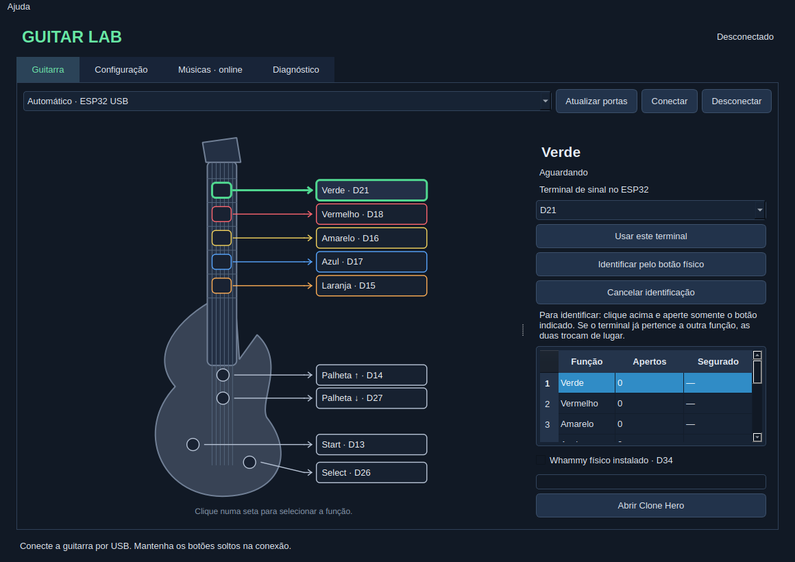
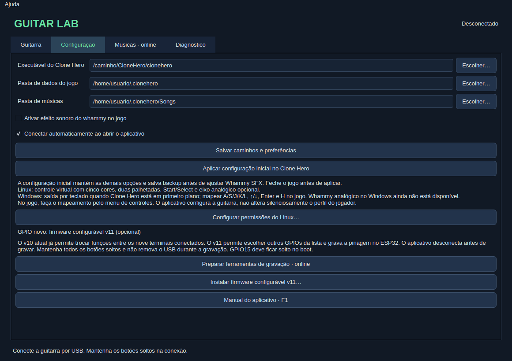
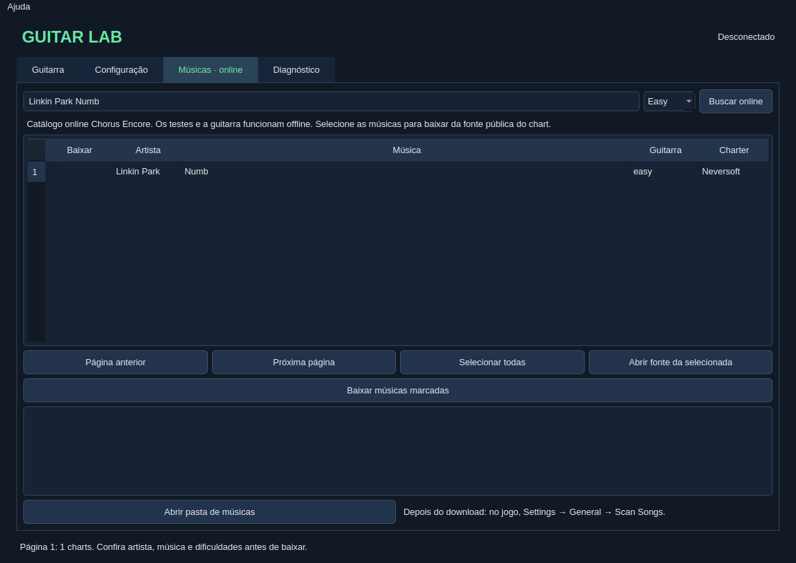

# Manual do Guitar Lab — {{VERSION}}

Configure e teste sua guitarra ESP32 por cabo e prepare o Clone Hero pela interface.

> **Versão beta.** No Zorin, a conexão real e o botão verde na janela foram confirmados pelo usuário. Linux e Windows passaram nos testes automáticos de código e interface. A guitarra física no Windows/ROG Ally, os demais controles na janela e uma partida completa usando o aplicativo ainda precisam de validação. Whammy analógico está disponível somente no Linux.

[TOC]

## 1. O que funciona em cada sistema

| Recurso | Linux x64 | Windows x64 |
| --- | --- | --- |
| Interface, guitarra visual e testes | Implementado; verde confirmado no Zorin | Implementado; testes automáticos aprovados |
| Conexão serial com ESP32 | Validada na bancada | Implementada; teste físico pendente |
| Saída para o jogo | Controle virtual Linux | Teclas, com Clone Hero em primeiro plano |
| Cinco cores, duas palhetadas, Start e Select | Implementados | Implementados por teclas |
| Whammy analógico | Opcional, D34 | Ainda indisponível |
| Busca e download de músicas | Online | Online |
| Remapeamento entre terminais existentes | Firmware v10 ou v11 | Firmware v10 ou v11 |
| Escolher GPIOs novos no ESP32 | Exige firmware v11 | Exige firmware v11 |

O aplicativo não instala o Clone Hero, não inclui músicas no pacote e não altera automaticamente o perfil de controles dentro do jogo.

## 2. Baixar e abrir

Baixe os arquivos em [GitHub Releases](https://github.com/yanxxavier/guitar_hero_esp32/releases). O repositório é privado: entre na sua conta do GitHub para acessar os downloads.

Escolha o pacote do seu sistema. Os arquivos “Source code” são para desenvolvimento; os pacotes GuitarLab incluem o aplicativo pronto, sem exigir instalação de Python.

### Windows 10/11 de 64 bits

1. Baixe **GuitarLab-{{VERSION}}-Windows-x64.zip**.
2. Clique com o botão direito no ZIP e escolha **Extrair tudo**.
3. Abra a pasta extraída e execute **GuitarLab.exe**.
4. Mantenha a pasta `_internal` ao lado do executável. Não mova somente o `.exe`.
5. Se o ESP32 não aparecer nas portas, use o link do driver CH340 na aba **Configuração**, que abre o fabricante WCH.

O pacote beta não tem assinatura de editor. Caso o Windows apresente um bloqueio de segurança, confira a origem e as políticas da sua máquina; o aplicativo não altera essas proteções.

### Linux/Zorin de 64 bits

1. Baixe **GuitarLab-{{VERSION}}-Linux-x64.tar.gz**.
2. Extraia o arquivo pelo gerenciador de arquivos.
3. Abra a pasta extraída e execute **GuitarLab**. Mantenha `_internal` junto dele.
4. Se o gerenciador de arquivos não permitir executar, confira em **Propriedades → Permissões** se o arquivo está marcado como programa.
5. Para criar um atalho no menu, execute o script opcional `instalar-menu.sh` incluído na pasta.

O pacote Linux é construído para sistemas x64 com glibc2.35 ou mais recente, como Ubuntu22.04+ e Zorin17/18. Outras distribuições podem precisar das bibliotecas gráficas Qt do sistema. Não execute o Guitar Lab como root.

### Atualizar uma versão

Feche o Guitar Lab, extraia o pacote novo numa pasta própria e abra o executável novo. Seu perfil fica fora da pasta do programa e é preservado. Se mover a pasta Linux, atualize também o atalho do menu pelo script incluído.

## 3. Primeira conexão

1. Feche o dashboard antigo, monitores seriais e outras instâncias do Guitar Lab.
2. Conecte o ESP32 com um cabo USB de dados. Deixe todos os botões soltos.
3. Abra a aba **Guitarra**.
4. Deixe a porta em **Automático · ESP32 USB** e clique **Conectar**. Se houver mais de um conversor USB, selecione a porta correta.
5. Aguarde **Guitarra conectada** e **Saída pronta**.
6. Aperte e solte um botão. A função correspondente deve acender, contar um aperto e voltar a **Solto**.

No Linux, se aparecer erro de acesso à serial ou ao controle virtual, abra **Configuração → Configurar permissões do Linux**. O próprio sistema poderá pedir autenticação para instalar as regras de dispositivo. O aplicativo continua sendo executado com seu usuário normal. Depois reconecte a guitarra.

O aplicativo tenta reconectar o USB enquanto a conexão estiver ativa. Ao clicar **Desconectar** ou fechar a janela, ele libera os comandos e encerra a ponte. Deixe a janela aberta durante a partida; você pode minimizá-la.

## 4. Conhecer a tela da guitarra

As telas deste manual são exemplos renderizados da interface, sem simular uma confirmação física de todos os controles.

- **Setas e rótulos:** clique numa função para selecioná-la no painel da direita.
- **Indicador colorido:** acompanha o sinal do switch recebido do ESP32.
- **Terminal de sinal:** mostra o GPIO atribuído à função selecionada.
- **Apertos:** conta transições de solto para pressionado durante a sessão.
- **Segurado:** mostra a duração atual do acionamento ou a duração do último acionamento concluído.
- **Identificar pelo botão físico:** associa o próximo botão pressionado à função selecionada.
- **Whammy físico instalado:** habilita a saída analógica opcional no Linux. Deixe desmarcado nesta montagem sem alavanca.

### Testar botões e notas longas

Aperte cada botão uma vez, verificando se somente a função correta acende. Depois segure uma cor por cinco segundos: o indicador deve permanecer aceso enquanto você segura. A palheta deve acionar cima ou baixo e voltar ao repouso quando solta.

No Clone Hero, uma nota longa normalmente é tocada segurando a cor, dando uma palhetada no início e mantendo a cor até o fim da cauda. Você pode deixar a palheta voltar ao repouso. Whammy não é necessário para sustentar a nota.

## 5. Identificar fios e trocar funções

Faça o remapeamento com o jogo fechado. O ESP32 deve estar conectado ao aplicativo.

### Descobrir qual fio vem de cada botão

1. Clique na seta **Verde** na guitarra.
2. Clique **Identificar pelo botão físico**.
3. Aperte somente o botão que você quer usar como verde.
4. Aguarde a confirmação de perfil salvo.
5. Repita para vermelho, amarelo, azul, laranja, palhetadas, Start e Select.

Se o terminal identificado já estiver atribuído a outra função, as duas funções trocam de lugar. Isso evita duplicar um terminal em dois comandos. **Cancelar identificação** encerra a espera pelo próximo botão.

### Escolher um terminal manualmente

1. Selecione a função pela seta.
2. Escolha o terminal na lista, por exemplo **D21**.
3. Clique **Usar este terminal**.
4. Aguarde a confirmação e teste o botão novamente.

No ESP32 deste projeto, a marcação D21 corresponde ao GPIO21. Para mudar a fiação física, desconecte o USB antes de mexer nos fios e reconecte com os botões soltos.

### Mapa inicial deste projeto

| Função | Terminal |
| --- | --- |
| Verde | D21 |
| Vermelho | D18 |
| Amarelo | D16 |
| Azul | D17 |
| Laranja | D15 |
| Palheta para cima | D14 |
| Palheta para baixo | D27 |
| Start | D13 |
| Select / Star Power | D26 |
| Whammy opcional | D34 |

Os switches normalmente abertos ligam cada GPIO ao GND comum. Mantenha o laranja/D15 solto ao ligar a placa. A falha antiga do azulD17 ainda não foi confirmada como reparada.

### Quando o firmware v11 é necessário

O firmware v10 já permite trocar funções entre os nove terminais do mapa inicial. Para ler um GPIO novo, como D25 ou D32, use o firmware configurável v11.

Na aba **Configuração**, selecione a porta correta e acione **Instalar firmware configurável v11**. Leia a confirmação antes de continuar: essa ação substitui o firmware da placa. Os pacotes da release incluem as imagens compiladas e o gravador; preparar as ferramentas não grava a placa. Mantenha o USB conectado durante a gravação e depois reconecte pela aba Guitarra.

GPIOs disponíveis no v11: D13, D14, D15, D16, D17, D18, D19, D21, D22, D23, D25, D26, D27, D32 e D33. Escolha nove terminais diferentes. A mudança só é confirmada no perfil depois da resposta do ESP32. O v11 foi compilado e incluído para teste; a gravação e a nova pinagem ainda precisam de validação física.

## 6. Preparar o Clone Hero

1. Em **Executável do Clone Hero**, escolha o programa do jogo.
2. Em **Pasta de dados do jogo**, escolha a pasta que contém `settings.ini`.
3. Em **Pasta de músicas**, escolha sua biblioteca de músicas.
4. Deixe **Ativar efeito sonoro do whammy no jogo** desmarcado para a montagem atual.
5. Clique **Salvar caminhos e preferências**.
6. Com o jogo fechado, clique **Aplicar configuração inicial no Clone Hero**.
7. Conecte a guitarra e clique **Abrir Clone Hero**.

A configuração inicial faz backup de `settings.ini` e ajusta somente Whammy SFX; preserva as demais opções. No Zorin deste projeto, o usuário confirmou que o som voltou ao normal depois de desligar esse efeito. O botão do whammy físico e seu efeito sonoro são opções independentes.

Pastas comuns:

| Sistema | Dados do jogo | Músicas |
| --- | --- | --- |
| Linux | `~/.clonehero` | `~/.clonehero/Songs` |
| Windows | `Documentos/Clone Hero` | `Documentos/Clone Hero/Songs` |

Instalações portáteis ou Documentos redirecionado para OneDrive podem usar outros caminhos. Escolha as pastas usadas pela sua instalação.

### Mapear no jogo — Linux

No menu principal do Clone Hero, pressione **Espaço** para abrir o mapeamento. Selecione o jogador e **Guitar Lab Virtual Controller**. Na coluna de controle, escolha cada ação e acione o botão físico correspondente. Salve em **Done**.

Faça isso para Green, Red, Yellow, Blue, Orange, Strum Up, Strum Down, Start e Select/Star Power. A pinagem da guitarra é configurada no Guitar Lab; as atribuições do jogador são confirmadas no próprio Clone Hero.

### Mapear no jogo — Windows

A saída atual usa as teclas abaixo quando `clonehero.exe` está em primeiro plano:

| Função | Tecla |
| --- | --- |
| Verde, vermelho, amarelo, azul, laranja | A, S, J, K, L |
| Palheta para cima / para baixo | Seta para cima / seta para baixo |
| Start | Enter |
| Select / Star Power | H |

Confira essas teclas na coluna **Keyboard** do mapeamento do Clone Hero. Deixe jogo e aplicativo com o mesmo nível normal de usuário, sem executar um deles como administrador. As teclas são liberadas ao perder foco. Esse modo não exige driver de gamepad virtual, mas ainda precisa de teste físico no Windows/Ally.

## 7. Buscar e baixar músicas

1. Abra **Músicas · online** e conecte o computador à internet.
2. Digite uma banda ou música, por exemplo **Linkin Park Numb**.
3. Escolha **Easy** para começar e clique **Buscar online**.
4. Confira artista, nome, dificuldades e charter. Uma música pode ter vários charts diferentes.
5. Marque uma ou várias linhas na coluna **Baixar**.
6. Clique **Baixar músicas marcadas** e aguarde o resultado de cada item.
7. No Clone Hero, execute **Settings → General → Scan Songs**.

Os testes da guitarra funcionam offline; somente busca, download e preparação de ferramentas que faltarem precisam de internet. Os pacotes da release não incluem músicas.

SNG, ZIP e pastas individuais são suportados. Alguns pacotes7z, arquivos removidos ou fontes com limite do Google Drive não podem ser importados automaticamente: confira a mensagem, abra a fonte da linha selecionada ou escolha outro chart. A fila não contorna quotas. Não mova arquivos temporários incompletos para o jogo.

## 8. Resolver problemas comuns

| Situação | O que conferir |
| --- | --- |
| Nenhuma porta aparece | Cabo de dados, USB, Atualizar portas e driver CH340 no Windows. |
| Porta ocupada / outra instância | Feche dashboard, monitor serial e outro Guitar Lab. |
| Erro de permissão no Linux | Use Configurar permissões do Linux, autentique no sistema e reconecte. |
| Guitarra conecta, mas jogo não responde | Confira Saída pronta, abra o jogo depois da conexão e revise o mapeamento do jogador. |
| Windows não recebe teclas | Clone Hero deve estar em primeiro plano; confira as teclas e evite níveis diferentes de administrador. |
| Cor errada acende | Refaça Identificar pelo botão físico ou escolha o terminal correto. |
| Botão pisca enquanto segurado | Confira encaixe, fio, solda e switch; use a duração no painel. Não altere a pinagem para esconder falha física. |
| Nota longa soa desafinada | Desative Whammy SFX na Configuração, aplique com jogo fechado e abra novamente. |
| Nota longa perde a cauda/combo | Confira se a cor permanece acionada e se há palhetada extra; isso precisa ser separado de mudança apenas sonora. |
| Músicas baixadas não aparecem | Confira a pasta e execute Scan Songs. No Linux, falhas da varredura ficam em `~/.clonehero/badsongs.txt`. |
| Janela não fecha durante operação | Aguarde a fila ou gravação em andamento terminar. |

A aba **Diagnóstico** mostra mensagens da sessão. Ao relatar um problema, informe sistema, versão do app, firmware, função afetada e mensagem exibida. Não envie credenciais ou backups de flash.

## 9. Perfil, backups e privacidade

O perfil e os backups ficam em `~/.config/guitar-lab` no Linux ou `%APPDATA%/GuitarLab` no Windows. A biblioteca de músicas fica na pasta escolhida. Atualizar ou mover o aplicativo não deve apagar esses dados.

O pacote de release contém somente aplicativo, manual, avisos de dependências e firmware compilado a partir do projeto. Não inclui o cofre Obsidian, músicas, logs, credenciais, flash de bancada nem o arquivo3MF da guitarra.

**Referências:** [repositório e releases](https://github.com/yanxxavier/guitar_hero_esp32), [manual oficial do Clone Hero](https://wiki.clonehero.net/books/clone-hero-manual), [scan de músicas](https://wiki.clonehero.net/books/clone-hero-manual/page/scanning-songs), [Chorus Encore](https://www.enchor.us/).
